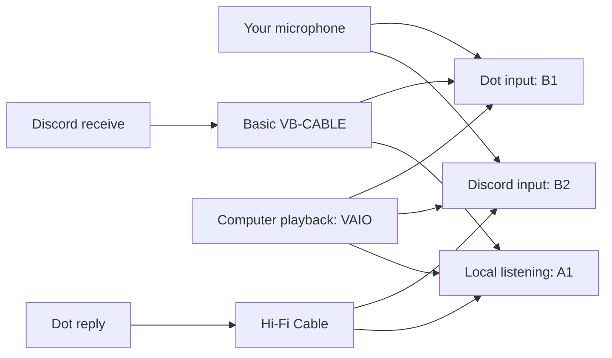

# Audio for Dots — Bring Your AI into Discord Conversations

**Give Jarvis a voice in the call: hear the people, discuss the work, and listen to live video audio together.**

A Windows audio-routing guide for making an AI dot part of a shared conversation. The main use case is **business and collaboration through Discord**: letting callers speak directly with Jarvis and hear its replies, while Jarvis can also hear the audio from live videos and other computer applications.

Powered by **Voicemeeter Banana + VB-Audio cables**. Includes the routing diagram, exact device choices, sharing modes and practical troubleshooting.

[Set it up](#setup) · [Understand the routing](#routing) · [Test a conversation](#verify-it) · [Troubleshoot](#troubleshooting)

## Why I made this

I made this so Jarvis could communicate with the people I call on Discord—mainly for business, not just gaming. I wanted it to hear the conversation, respond to callers, and listen to live video audio with us, rather than depend on me relaying everything back and forth.

Another goal is communication with other dots through the same shared voice environment. This guide provides an audio-routing foundation for that idea; dot-to-dot conversations and turn-taking have not been validated here, and no agent-to-agent messaging protocol is included.

The practical challenge is deciding who hears what. Jarvis needs the microphone, Discord callers and computer audio. Callers need the intended reply without hearing their own voices returned. Local listening still needs to work. This project makes those paths explicit and turns the setup experience into steps other people can reproduce.

**VB-Audio provides the mixing engine and virtual devices.** The contribution here is the integration guide, routing model, tests and troubleshooting. It is not a replacement for Voicemeeter or an official OpenAI integration; a custom setup companion is not included.

## Conversations this is designed to support

- **Business calls:** bring Jarvis into a discussion with collaborators so people can address it directly and hear the response.
- **Live video listening:** let Jarvis hear the audio from a presentation, broadcast or video and discuss what was said. This routes sound; it does not provide video frames or screen vision.
- **Shared work:** discuss a proposal, idea or problem while participants and the dot hear the same relevant computer audio.
- **Other dots:** explore voice interaction with another dot in a shared call. This remains an intended use case requiring its own routing and conversation tests.

## Try the workflow

1. Explain a question or business problem to Jarvis, then have another Discord caller address it directly.
2. Play a live video or a short clip and ask about something audible in it.
3. Confirm that callers can hear the reply clearly and do not hear their own voices returned.

The recorded combined-input test covered two people and video audio on one Windows setup. It did not establish business-task accuracy, every live-video service or dot-to-dot reliability. See [what has actually been tested](#what-has-actually-been-tested).

## What this enables

- Talk to your dot while it also hears people in your Discord call.
- Let it hear videos, music and other apps using Windows default playback.
- Send the dot's spoken replies to your callers without sending those replies back into its own input.
- Keep listening locally through your audio interface or headphones.

This carries audio. It does not give the dot video frames or screen vision.

## Dependencies

- Windows and a ChatGPT/dot voice interface that lets you select an audio input.
- [Voicemeeter Banana](https://vb-audio.com/Voicemeeter/banana.htm).
- [VB-CABLE](https://vb-audio.com/Cable/) and [Hi-Fi Cable](https://vb-audio.com/Cable/index.htm#DownloadASIOBridge), providing two distinct cable pairs.
- Discord desktop and your existing microphone/headphones or audio interface.

Download drivers from VB-Audio. Installation can require administrator access and a restart. Banana and the cables are third-party donationware; review [VB-Audio's licensing terms](https://vb-audio.com/Services/licensing.htm), including professional-use requirements. They are not open-source components of this repository.

## Routing

The names B1 and B2 are important: B1 feeds the dot; B2 feeds Discord's microphone input.

| Banana source | Local headphones A1 | Dot B1 | Discord microphone B2 |
| --- | --- | --- | --- |
| Your microphone | Optional direct monitoring | On | On |
| Discord receive, through basic VB-CABLE | On | On | **Off** |
| Dot playback, through Hi-Fi Cable | On | **Off** | On in voice-sharing mode |
| Computer playback, through VAIO | On | On | On in voice-sharing mode |

## Setup

1. Record your existing Windows and application device choices so you can restore them. Start at modest levels.
2. Choose your listening device as Banana A1. Choose your microphone on hardware input 1. Confirm the actual microphone channel before routing it.
3. Choose **CABLE Output** on hardware input 2. This strip receives Discord, and must never feed B2.
4. Choose **Hi-Fi Cable Output** on hardware input 3. This strip receives the dot, and must never feed B1.
5. Apply the routing table above. Keep virtual buses stereo; do not turn the whole mix mono merely to fix a microphone channel.
6. Set Discord output to **Speakers (VB-Audio Virtual Cable)** and Discord input to **Voicemeeter Out B2**.
7. Set the dot's call microphone to **Voicemeeter Out B1**, and its playback to **Hi-Fi Cable Input**. Check the selector inside the call: Windows defaults alone may not override an explicit app selection.
8. Set Windows default playback to **Voicemeeter Input (VAIO)** for ordinary computer apps. Keep Discord and the dot assigned to their separate outputs. Apps with an explicit device or ASIO driver can bypass the Windows default.
9. Test the microphone, friend and program audio separately. Save the working Banana preset only after checking each path.

Banana must be running for its virtual default playback device to produce local sound. Keep an easy route back to your physical playback device if Banana is stopped.

### ASIO interfaces

When A1 uses your interface's ASIO driver, use Banana's ASIO input patch to select the microphone channel. Avoid opening the same interface simultaneously as both ASIO A1 and WDM/MME microphone input. Channel numbers depend on the interface: the tested Apollo Twin USB setup used analog input 2; do not assume input 2 is correct for your hardware. See [VB-Audio's ASIO setup guide](https://voicemeeter.com/setup-a-mic-with-your-asio-audio-interface/).

## Voice sharing versus screen streaming

**Voice-sharing mode:** B2 includes your microphone, programs and the dot reply. Keep Discord stream sound off to avoid sending the same audio twice. This was the route used for the explicit improved-music-quality report.

**Screen-stream test mode:** B2 carries only your microphone; turn off every non-mic B2 send. Keep local A1 and dot B1 routes as shown. Use Discord's screen share with audio for the program/reply delivery. Friends must watch the stream to receive its sound. Restore the non-mic B2 sends when returning to voice-sharing mode.

Discord controls native screen-stream capture. Banana's bus switches do not select the stream's audio source or prove that Discord excludes its own receive audio. Check whole-screen behavior with your actual interface and Discord version. Stream capture may bypass Banana's program gain, so check stream loudness independently. See [Discord's screen-sharing guide](https://support.discord.com/hc/en-us/articles/360040816151-Go-Live-and-Screen-Share).

## Verify it

1. Ask the dot to respond to you, then have a friend speak. Both should reach the dot.
2. Play a short video and ask the dot about something audible in it.
3. Have friends confirm that your voice and the dot's reply are both clear.
4. Play music long enough to check for fading or distortion.
5. Have a friend speak while you are quiet: they should not hear themselves returned.
6. For stream mode, have a viewer mute the stream: only your microphone should remain. Unmute it: program/reply audio should appear once, without the friend's own voice returning.

## What has actually been tested

One Windows setup using an Apollo Twin USB, Banana 2.1.3.0, the two cables and Discord was tested interactively. Friends confirmed microphone reception and substantially improved Chrome music quality. A combined-input test included the local speaker, a Discord friend and video audio; the dot responded to both speakers and repeated a sentence from the video. The operator subsequently reported that everything worked.

That is evidence for this setup, not a compatibility guarantee. Sustained stream quality, return balance and absence of echo should each be checked on every new setup. Protected media, apps bypassing Windows playback, other ChatGPT clients and different audio interfaces are not established by that test.

## Troubleshooting

| Symptom | Check |
| --- | --- |
| Dot hears friends but not you | Its call microphone must be B1, not CABLE Output. |
| Friends hear themselves | Discord receive strip must not feed B2; also test stream capture separately. |
| Dot hears itself | Dot playback must not feed B1 or the general shared-program device. |
| Friends hear no music | Check the selected delivery mode: B2 for voice sharing, stream audio for streaming. |
| You hear no computer sound | Banana must be running; A1 and the program strip must be enabled and point to your headphones/interface. |
| Quiet dot reply | Check the dot's actual output device, app volume and its dedicated Banana strip; avoid raising every source together. |
| Banana opens but Apollo A1 stays blank | Match Banana's 32/64-bit build to the installed ASIO driver; the tested Apollo USB setup required Banana 64-bit. |
| Duplicate music/reply | Check whether both B2 and the screen stream are carrying it. |

## Project status

This first publication is a guide. A polished setup/control companion is planned, not included. No custom mixer executable, installer, private device preset, session log, credential or vendor binary is included. No project license has been selected yet; third-party products retain their own terms.

Independent, unofficial community project. No affiliation with or endorsement by OpenAI, Discord or VB-Audio is implied.

## Help improve the guide

If this helped, star the repository so you can find it again. To report a problem or add a confirmed setup, [open an issue](https://github.com/emetwebstudio/dot-audio-guide/issues) with your Windows version, audio interface, sharing mode and which test failed. Share reproducible steps rather than personal device logs or credentials.
